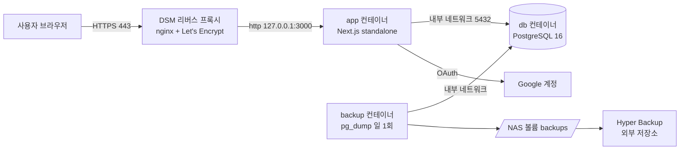
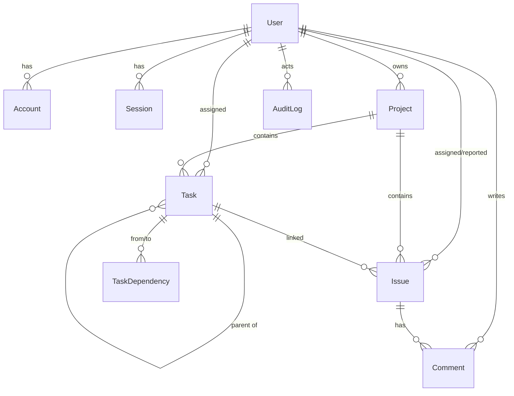
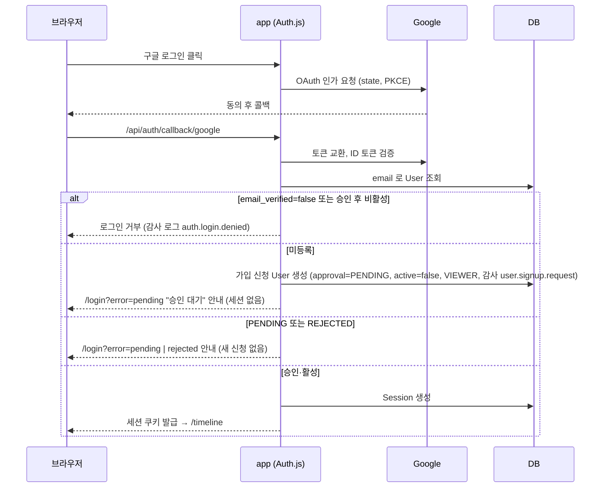
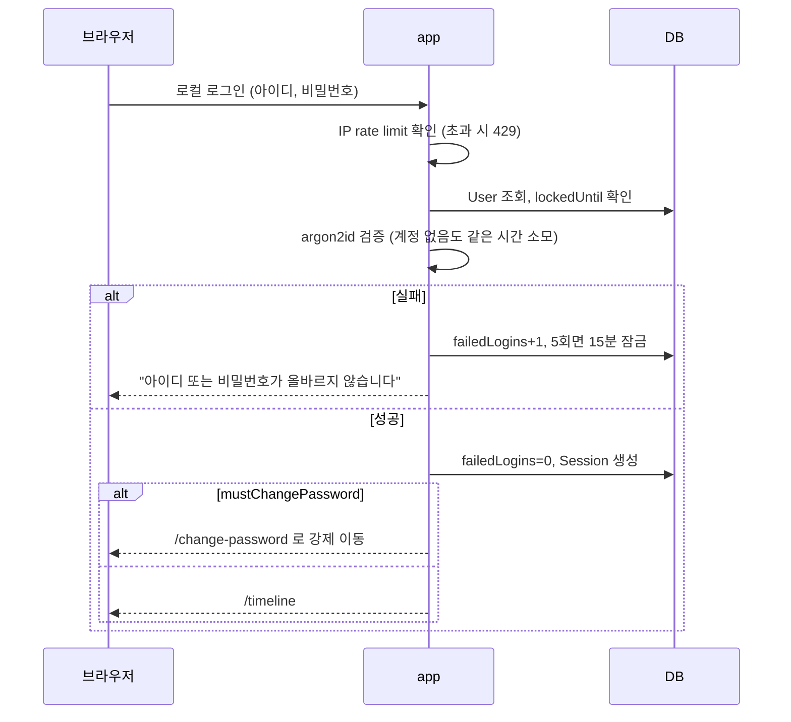

# one-sch 기술 설계서

> 여러 IT 프로젝트의 일정·진행 상황·이슈를 한 화면에서 관리하는 소규모 프로젝트 타임라인 웹서비스

| 항목 | 내용 |
|---|---|
| 문서 상태 | 초안 (검토 전) |
| 작성일 | 2026-11-20 |
| 대상 저장소 | `github.com/blindrift/one-sch` |
| 배포 대상 | 시놀로지 NAS (x86_64) Docker, 인터넷 HTTPS 공개 |

---

## 1. 개요

### 1.1 목적
동시에 진행되는 IT 프로젝트 여러 개를 **하나의 타임라인 화면**에서 보고, 프로젝트별 작업 일정과 이슈를 함께 관리한다. ClickUp·Jira·Asana 같은 서비스의 간트/보드/이슈 화면을 벤치마킹하되, 10명 이내 팀이 자체 NAS 에서 운영할 수 있는 크기로 만든다.

### 1.2 목표
- 전 프로젝트 일정을 한 간트 차트에 겹쳐 보고, 드래그로 일정을 바꾼다.
- 작업 단위 진행률과 이슈(문제·위험·요청)를 프로젝트별로 추적한다.
- 인터넷에 공개해도 안전한 구조를 기본값으로 둔다(허용 목록 로그인, 최소 노출, 감사 로그).
- NAS 한 대에서 운영·백업·복구가 쉽다.

### 1.3 범위

| 구분 | 포함 (MVP) | 제외 (이후 검토) |
|---|---|---|
| 일정 | 멀티 프로젝트 간트, 작업 계층(상위/하위), 마일스톤, 의존 관계(FS), 드래그 편집, 일/주/월 줌 | 자원 부하(Workload), 기준선(Baseline) 비교, 자동 일정 재계산 |
| 이슈 | 이슈 등록·상태·우선순위·담당자·마감일·댓글 | 첨부 파일, 이메일/메신저 알림 |
| 보기 | 간트, 칸반 보드, 목록(표), 대시보드 | 캘린더 뷰, 화이트보드, 문서 |
| 관리 | 사용자·역할 관리, 감사 로그 | 프로젝트별 세부 권한, 외부 API·웹훅 |
| 인증 | 구글 SSO(허용 목록), 로컬 admin 계정 | 2단계 인증(TOTP), 다른 IdP |

---

## 2. 요구사항

### 2.1 기능 요구사항

| ID | 요구사항 |
|---|---|
| F-01 | 전 프로젝트 타임라인: 프로젝트별 그룹·색상, 접기/펼치기, 오늘 선, 일/주/월 줌, 프로젝트·담당자·상태 필터 |
| F-02 | 작업 막대를 드래그해 시작·종료일 변경, 끝을 늘려 기간 변경, 진행률 변경 |
| F-03 | 작업 간 의존 관계(선행 완료 → 후행 시작) 화살표 표시·추가·삭제, 순환 의존 거부 |
| F-04 | 프로젝트 CRUD(이름, 키, 색상, 상태, 기간, 책임자, 보관) |
| F-05 | 작업 CRUD(상위 작업, 제목, 기간, 진행률, 상태, 담당자, 마일스톤 여부) |
| F-06 | 이슈 CRUD + 댓글, 작업과 연결 가능 |
| F-07 | 칸반 보드: 상태 열 사이 드래그로 작업/이슈 상태 변경 |
| F-08 | 목록 보기: 정렬·필터·검색 |
| F-09 | 대시보드: 프로젝트별 진행률, 지연 작업, 열린 이슈(우선순위별), 마감 임박(7일) |
| F-10 | 로그인: 구글 SSO(허용 목록), 로컬 계정(admin) |
| F-11 | 관리자: 사용자 등록·역할 변경·비활성화·세션 강제 종료·잠금 해제 |
| F-12 | 감사 로그: 로그인/로그아웃, 사용자·권한 변경, 데이터 변경 전후 값 기록·조회 |

### 2.2 비기능 요구사항

| ID | 요구사항 |
|---|---|
| N-01 | 사용자 10명 이내, 프로젝트 수십 개, 작업 수천 건 기준 간트 첫 표시 2초 이내 |
| N-02 | 시놀로지 x86_64 NAS, 메모리 합계 1GB 이내(app 512MB, db 384MB) |
| N-03 | 일 1회 자동 백업, 7일 보관, 복구 절차 문서화 |
| N-04 | 최신 Chrome·Edge·Safari 지원, 데스크톱 우선(1280px 이상), 모바일은 조회 위주 |
| N-05 | 한국어 UI, 시간대 Asia/Seoul, 날짜는 일 단위(작업 기간은 시각 없이 날짜만) |

### 2.3 보안 요구사항

| ID | 요구사항 |
|---|---|
| S-01 | 등록된 사용자만 로그인한다. 구글 계정 자동 가입 없음 |
| S-02 | 기본 계정(admin/admin)은 첫 로그인 시 비밀번호 변경을 강제하고, 변경 전에는 다른 기능을 쓸 수 없다 |
| S-03 | 모든 서버 쓰기·읽기 경로에서 서버 측 권한 검사를 한다(화면 숨김에 의존하지 않는다) |
| S-04 | 로그인 무차별 대입을 계정 잠금과 IP 단위 제한으로 막는다 |
| S-05 | 비밀정보(세션 서명 키, OAuth 시크릿, DB 비밀번호)는 저장소·이미지에 넣지 않는다 |
| S-06 | DB 는 외부·호스트에 포트를 열지 않는다 |
| S-07 | HTTPS 전용, 보안 헤더(CSP·HSTS 등) 적용 |
| S-08 | 권한·데이터 변경을 감사 로그로 남긴다 |

---

## 3. 시스템 아키텍처

### 3.1 구성도



### 3.2 컨테이너·네트워크

| 컨테이너 | 이미지 | 노출 | 네트워크 | 볼륨 |
|---|---|---|---|---|
| app | 자체 빌드 (node:22-alpine 기반, linux/amd64) | `127.0.0.1:3000` 만 (리버스 프록시 전용) | `frontend`, `backend` | 없음 (read-only, `/tmp` tmpfs) |
| db | postgres:16-alpine (버전 고정) | 없음 | `backend` (internal) | `./data/postgres` |
| backup | postgres:16-alpine + cron 스크립트 | 없음 | `backend` (internal) | `./backups` |

- `backend` 네트워크는 `internal: true` 로 만들어 외부로 나가는 경로도 막는다. app 은 구글 OAuth 통신을 위해 `frontend` 네트워크로만 외부에 나간다.
- 호스트에 열리는 포트는 app 의 `127.0.0.1:3000` 하나뿐이다. 외부에서는 DSM 리버스 프록시(443)로만 들어온다.

### 3.3 애플리케이션 구조

```
one-sch/
├─ docs/                    설계서·배포 문서
├─ prisma/                  schema.prisma, migrations/, seed.ts
├─ src/
│  ├─ app/                  Next.js App Router 화면·route handler
│  │  ├─ (auth)/login, change-password
│  │  ├─ (main)/timeline, projects/[key], issues, dashboard
│  │  ├─ admin/users, admin/audit
│  │  └─ api/auth/[...nextauth], api/health
│  ├─ server/               서버 전용 코드 (import 'server-only')
│  │  ├─ auth/              Auth.js 설정, requireRole, 잠금·rate limit
│  │  ├─ actions/           도메인별 Server Action (project, task, issue, user)
│  │  ├─ services/          비즈니스 로직 (의존 순환 검사, 진행률 계산)
│  │  ├─ audit.ts           감사 로그 기록
│  │  └─ db.ts              Prisma 클라이언트
│  ├─ lib/validation/       Zod 스키마 (클라이언트·서버 공용)
│  ├─ components/           UI (gantt, board, table, ui/shadcn)
│  └─ middleware.ts         인증·강제 비밀번호 변경·CSP nonce
├─ tests/unit, tests/e2e
├─ Dockerfile, docker-compose.yml, .env.example
└─ scripts/                 build-amd64.sh, backup.sh, restore.sh
```

---

## 4. 기술 스택과 선정 근거

| 영역 | 선택 | 근거 |
|---|---|---|
| 프레임워크 | Next.js 15 (App Router) + TypeScript | 화면과 서버 로직을 한 코드베이스·한 컨테이너로 운영. Server Action 으로 별도 REST 계층 없이 타입 안전하게 호출 |
| 인증 | Auth.js v5 | 구글 provider, database 세션, CSRF 보호 내장 |
| ORM | Prisma | 스키마·마이그레이션 관리, 파라미터 바인딩 기본 |
| DB | PostgreSQL 16 | 아래 비교 참고 |
| 검증 | Zod | 클라이언트·서버 공용 스키마 |
| UI | Tailwind CSS + shadcn/ui | 소스 복사형 컴포넌트라 외부 런타임 의존이 적음 |
| 간트 | SVAR React Gantt (`@svar-ui/react-gantt`, MIT) | 드래그·의존 화살표·줌 지원. 요구에 안 맞으면 직접 SVG 렌더로 교체 (1단계 PoC 에서 결정) |
| 칸반 | `@dnd-kit` | 접근성 지원, 가벼움 |
| 비밀번호 해시 | argon2id (`@node-rs/argon2`) | OWASP 권장 알고리즘 |
| 테스트 | Vitest, Playwright | 단위·E2E |

### 4.1 DB 선택: PostgreSQL vs SQLite

| 기준 | PostgreSQL | SQLite |
|---|---|---|
| 운영 구성 | 컨테이너 1개 추가 | 앱 컨테이너 내 파일 |
| 동시 쓰기 | 문제 없음 | WAL 로 10명 수준은 충분 |
| 네트워크 노출 | 내부 네트워크로 차단 가능 | 노출면 없음 |
| 백업 | pg_dump (일관성 보장) | 파일 복사 (쓰기 중 복사 주의) |
| 확장성 | 사용자 증가·외부 도구 연동(BI 등)에 유리 | 단일 프로세스 한정 |
| 앱 컨테이너 read-only | 가능 | DB 파일 쓰기 볼륨 필요 |

**결정: PostgreSQL.** 앱 컨테이너를 상태 없는 read-only 로 유지할 수 있고, 백업 일관성과 이후 확장에 유리하다. 내부 네트워크 전용으로 두어 노출면 차이는 없앤다.

---

## 5. 데이터 모델

### 5.1 ERD



### 5.2 테이블 정의 (주요 컬럼)

**User**
| 컬럼 | 타입 | 설명 |
|---|---|---|
| id | uuid PK | |
| email | text unique | 구글 SSO 매칭 키 (소문자 정규화) |
| name | text | |
| role | enum ADMIN/MEMBER/VIEWER | |
| passwordHash | text null | 로컬 로그인 계정만 |
| mustChangePassword | bool | 기본 admin 은 true |
| active | bool | false 면 로그인·세션 모두 거부 |
| failedLogins | int | 연속 실패 횟수 |
| lockedUntil | timestamptz null | 잠금 해제 시각 |
| lastLoginAt, createdAt, updatedAt | timestamptz | |

**Account / Session**: Auth.js Prisma 어댑터 표준 스키마. Session 에 `lastSeenAt`, `ip`, `userAgent` 추가.

**Project**
| 컬럼 | 타입 | 설명 |
|---|---|---|
| id | uuid PK | |
| key | varchar(10) unique | 예: `ERP`, URL 에 사용 |
| name | text | |
| color | char(7) | `#RRGGBB` |
| status | enum PLANNED/ACTIVE/ON_HOLD/DONE | |
| startDate, endDate | date | |
| ownerId | uuid FK User | |
| archived | bool | 보관 시 기본 화면에서 숨김 |
| version | int | 낙관적 잠금(2단계 0002 마이그레이션에서 추가) |

- 프로젝트는 실제로 지우지 않고 보관/보관 해제만 한다(D1). 7.4 의 "삭제"는 프로젝트에 대해서는 보관을 뜻한다.
- 키는 생성 후 바꾸지 않는다(D3, URL·이슈 번호 안정성).
- 보관된 프로젝트의 작업·의존은 읽기 전용이다(쓰기 요청은 CONFLICT `archived`, D6).
  - 예외: 활성 프로젝트의 작업을 삭제하면 그 작업에 걸린 의존은 상대가 보관 프로젝트의 작업이어도 함께 지운다(DB cascade, 감사 `task.delete` before.dependencies 에 남음). 보관 프로젝트 때문에 활성 작업 삭제를 막지 않기 위해서다.
  - 상위 작업을 바꿀 때도 옮기는 작업·후손과 새 상위·조상 사이에 의존이 있으면 거부한다(VALIDATION `hierarchy`, D14 와 같은 규칙).
- 책임자(owner)·담당자(assignee) 후보는 활성 사용자 전원이다(역할 무관). 화면에는 id·이름만 내려보낸다(D8).

**Task**
| 컬럼 | 타입 | 설명 |
|---|---|---|
| id | uuid PK | |
| projectId | uuid FK | |
| parentId | uuid FK Task null | 같은 프로젝트 내에서만 |
| title | text | |
| startDate, endDate | date | `endDate >= startDate`, 마일스톤은 같은 날 |
| progress | smallint | 0–100 |
| status | enum TODO/IN_PROGRESS/BLOCKED/DONE | |
| assigneeId | uuid FK User null | |
| isMilestone | bool | |
| sortOrder | int | 간트·목록 정렬 |
| version | int | 낙관적 잠금 (동시 편집 충돌 감지) |
| url | text null | 관련 링크 하나. `http:`·`https:` 만 허용, 2000자 이하(CHECK). 빈 값은 NULL |
| memo | text null | 여러 줄 평문 메모. 줄바꿈·탭 외 제어 문자 거부, 5000자 이하(CHECK). 빈 값은 NULL |

- 상위 작업은 같은 프로젝트 안에서만 바꿀 수 있고, 자기 후손 밑으로는 갈 수 없다. 계층 깊이는 최대 5, 마일스톤은 상위가 될 수 없다(D13).
- 하위 작업이 있는 상위 작업의 기간·진행률은 하위에서 자동으로 다시 계산해 같은 트랜잭션에서 DB 에 저장한다. 하위가 있는 동안에는 상위의 기간·진행률을 직접 편집·드래그할 수 없다(D4). 재계산된 조상의 `version` 도 올라간다.
- 하위가 있는 작업을 지우면 확인 대화상자를 거쳐 하위·의존까지 연쇄 삭제하고, 감사 로그에 지운 하위·의존 목록을 남긴다(D7).
- 상태와 진행률은 서로 연동하지 않는다(D11).
- 같은 프로젝트의 작업 쓰기는 프로젝트 단위 advisory xact lock 으로 줄 세운다(상위 재계산·부모 순환 검사의 경쟁 방지).

**TaskDependency**: `(fromTaskId, toTaskId)` unique, `type` = FS. 같은 프로젝트 또는 프로젝트 간 허용, 추가 시 순환 검사(전역 advisory lock 안에서 다시 검사). 조상·후손 사이의 의존은 거부한다(D14). FS 는 화살표로 표시만 하고 일정을 강제·자동 조정하지 않는다(D5).

**Issue**
| 컬럼 | 타입 | 설명 |
|---|---|---|
| id | uuid PK | |
| projectId | uuid FK | |
| number | int | 프로젝트 내 일련번호 (`ERP-12`) |
| taskId | uuid FK null | |
| title | text | |
| description | text | 마크다운 |
| type | enum ISSUE/RISK/REQUEST | |
| status | enum OPEN/IN_PROGRESS/RESOLVED/CLOSED | |
| priority | enum LOW/MEDIUM/HIGH/URGENT | |
| assigneeId, reporterId | uuid FK User | |
| dueDate | date null | |
| version | int | 낙관적 잠금 |

- 번호(`number`)는 프로젝트별 일련번호다. 이슈를 만들 때 프로젝트 잠금(advisory xact lock) 안에서 `Project.issueSeq` 를 1 올려 그 값을 쓴다(빈 번호 재사용 없음, 이슈를 지워도 번호는 돌아오지 않음). 이 증가는 프로젝트 편집이 아니므로 `Project.version` 은 올리지 않는다(D22). `(projectId, number)` unique.
- 화면 표기는 `KEY-번호`(예: `ERP-12`). 상세 패널 URL 은 `?issue=ERP-12`, 검색창에 `ERP-12` 를 넣으면 번호로 찾는다.
- 제목 1–200자, 설명 20,000자 이하(0005 CHECK). 담당자는 활성 사용자만(D8), 보고자는 만든 사람. 연결 작업(`taskId`)은 같은 프로젝트의 작업만(다른 프로젝트 id 는 VALIDATION). 연결된 작업을 지우면 `taskId` 는 NULL(FK SetNull). 이 해제는 이슈의 감사·version 에 남지 않으므로 작업 삭제 감사(`task.delete` before.`unlinkedIssues`)에 이슈 id 를 남긴다.
- 보관된 프로젝트의 이슈·댓글은 읽기 전용이다: 이슈 생성·수정·삭제·보드 이동·댓글 작성·수정·삭제 모두 CONFLICT `archived`(D18, D6 확장).
- 이슈 삭제는 MEMBER 이상이 실제 삭제한다. 댓글은 DB cascade 로 함께 지워지고, 감사 `issue.delete` before 에 이슈 스냅샷과 댓글 수를 남긴다(D21).
- 쓰기는 `version` 낙관적 잠금. 바뀐 필드가 없으면 감사·version 변경 없음.
- 상한: 이슈 보드는 프로젝트당 최근 번호 1,000건까지 싣고(넘으면 안내), 상세 패널은 최근 댓글 200건(오래된 것은 건수만 안내).

**Comment**: `id, issueId, authorId, body(마크다운), createdAt, updatedAt, deletedAt`
- 본문 1–20,000자(0005 CHECK). VIEWER 이상 누구나 작성, 수정은 작성자 본인만, 삭제는 작성자 본인 또는 ADMIN(D21).
- 삭제는 `deletedAt` 소프트 삭제다. 지운 댓글은 화면에 "삭제된 댓글"로만 남고 본문은 내려보내지 않는다. 지운 댓글은 수정할 수 없다(NOT_FOUND).
- 수정은 version 없이 마지막 저장이 이긴다(작성자 한 사람만 고칠 수 있어 충돌 위험이 작다).
- 감사: `comment.create`·`comment.update`(본문 전후)·`comment.delete`.
- 이슈 하나의 댓글은 지운 것 포함 1,000개까지(넘으면 VALIDATION `comment_limit`).
- 보존(수용, 리뷰 S-2): 지운 댓글의 본문은 DB 행과 감사(`comment.delete` before.body, `comment.update` 전후, `issue.delete` before.description)에 그대로 남는다. 화면·DTO 로는 내려보내지 않는다. 개인정보 삭제 요청 등에 대비한 ADMIN 전용 purge(본문 지우기·감사 마스킹)는 다음 단계 후보다.

**마크다운(이슈 설명·댓글)**: `react-markdown` + `remark-gfm`(표·체크리스트·취소선) 서버 컴포넌트 렌더(D23).
- raw HTML 은 렌더하지 않는다(`skipHtml`, `rehype-raw` 금지, `dangerouslySetInnerHTML` 금지 — 정적 검사).
- 링크는 `http:`·`https:`·`mailto:` 만 남기고 나머지(`javascript:`·`data:`·`vbscript:` 와 그 변형)는 지운다. 링크는 새 창(`target=_blank`, `rel="noopener noreferrer nofollow"`).
- 이미지는 그리지 않고 링크로 바꾼다(CSP `img-src` 가 self·data·구글 프로필만 허용하므로 외부 이미지를 열지 않는다).

**AuditLog**
| 컬럼 | 타입 | 설명 |
|---|---|---|
| id | bigserial PK | |
| at | timestamptz | |
| actorId | uuid null | 로그인 실패 등은 null |
| action | text | 예: `auth.login.success`, `task.update` |
| entity, entityId | text | |
| before, after | jsonb | 변경 필드만 |
| ip, userAgent | text | |

- 앱 DB 계정에 AuditLog 의 UPDATE/DELETE 권한을 주지 않는다(append-only).
- 소프트 삭제: Project 는 `archived`, Comment 는 `deletedAt`. Task·Issue 삭제는 실제 삭제하고 감사 로그에 이전 값을 남긴다.

---

## 6. 화면·기능 명세

| 경로 | 화면 | 주요 기능 | 최소 권한 |
|---|---|---|---|
| `/login` | 로그인 | 구글 로그인 버튼, 로컬 로그인 폼(설정으로 숨김 가능) | 없음 |
| `/change-password` | 비밀번호 변경 | 강제 변경, 정책 안내 | 로그인 |
| `/timeline` | **전체 타임라인 (기본 화면)** | 프로젝트별 그룹 간트, 줌, 오늘 선, 필터, 드래그 편집, 의존 화살표 | VIEWER (편집 MEMBER) |
| `/projects` | 프로젝트 목록 | 생성·수정·보관 | VIEWER |
| `/projects/[key]` | 프로젝트 상세 | 탭: 간트 / 보드 / 목록 / 이슈 | VIEWER |
| `/issues` | 전체 이슈 | 필터(프로젝트·상태·우선순위·담당자), 상세 패널, 댓글 | VIEWER |
| `/dashboard` | 대시보드 | 프로젝트 진행률, 지연 작업, 열린 이슈, 마감 임박 | VIEWER |
| `/admin/users` | 사용자 관리 | 등록(이메일·이름·역할), 역할 변경, 비활성화, 세션 종료, 잠금 해제, 비밀번호 초기화 | ADMIN |
| `/admin/audit` | 감사 로그 | 기간·사용자·대상 필터, 변경 전후 비교 | ADMIN |

### 6.1 타임라인 상세
- 왼쪽: 프로젝트 → 작업(계층) 트리, 담당자, 기간, 진행률 컬럼. 오른쪽: 막대 영역.
- 막대 색은 프로젝트 색, 진행률은 막대 내부 채움, 지연(종료일 경과 + 미완료)은 빨간 테두리.
- 프로젝트 행은 하위 작업의 최소 시작~최대 종료를 요약 막대로 표시.
- 드래그 결과는 Server Action 으로 즉시 저장하고 실패 시 원위치로 되돌린 뒤 사유를 표시한다. 동시 편집 충돌(`version` 불일치)은 최신 값을 다시 불러온다.
- 진행률 계산: 하위 작업이 있으면 기간 가중 평균(마일스톤은 가중치 1일), 없으면 입력값.
- 지연 판정은 6.2 와 같다: `endDate < 오늘(Asia/Seoul) AND status != DONE`. 요약 행(하위가 있는 작업·프로젝트 행)은 지연 판정에서 뺀다(D11). "오늘"은 서버가 Asia/Seoul 로 계산해 내려준다.
- 작업이 없는 프로젝트는 프로젝트 기간이 있으면 그 기간으로 요약 막대를 그리고, 없으면 막대 없이 행만 둔다(D16).
- 보관된 프로젝트는 기본으로 숨기고, "보관 포함" 토글을 켜면 읽기 전용으로 보인다(D6).
- 필터(프로젝트·담당자·상태)와 줌은 URL query 에 보관한다. VIEWER 에게는 읽기 전용으로 보인다.
- 작업 추가·수정은 대화상자로 한다(행 더블클릭 → 수정). 간트 표의 행 드래그와 간트 라이브러리 내장 편집기는 쓰지 않는다(D10). 행 순서는 프로젝트의 목록 탭에서 바꾼다(D17): 정렬이 "순서"이고 필터·검색이 없을 때만, 같은 상위 아래 형제끼리 끌어 옮긴다. 간트는 새로고침하면 바뀐 순서로 보인다. 새 작업의 `sortOrder` 는 프로젝트 안 `max+1`.
- 날짜는 서버·DTO 모두 `YYYY-MM-DD` 문자열(포함 종료일)이고, 간트 라이브러리(배타 종료일, 로컬 자정)와의 변환은 한 모듈(`src/components/gantt/adapter.ts`)에서만 한다.
- `/projects/[key]` 는 탭 4개다(D9): 간트(`/projects/[key]`, 타임라인 컴포넌트를 그 프로젝트로 필터), 보드(`/board`), 목록(`/list`), 이슈(`/issues`). 탭은 링크(`aria-current`)이고 없는 키는 404.

### 6.1.1 보드·목록·이슈 (3단계)
- **보드**: 상태 열(작업: 할 일·진행 중·막힘·완료, 이슈: 열림·진행 중·해결·닫힘). `?kind=issue` 로 작업|이슈 전환. 작업 보드는 기본으로 하위가 없는 작업과 마일스톤만 보이고 "상위 작업 포함" 토글(`?parents=1`)로 상위도 보인다. 열 안 순서는 종료일(이슈는 마감일, 없으면 뒤) 순(D20). 카드를 다른 열로 끌면(마우스·키보드) 화면을 먼저 옮기고 `updateTask`/`updateIssue({id, version, status})` 로 저장, 실패하면 되돌리고 사유를 보이며 CONFLICT·NOT_FOUND 면 최신 값을 다시 읽는다. VIEWER·보관 프로젝트는 끌 수 없다. 카드를 누르면 작업은 작업 대화상자, 이슈는 상세 패널.
- **목록**: 작업 표(서버 렌더). 정렬(순서·제목·시작·종료·진행률·상태)·필터(상태·담당자)·검색(제목)·페이지(50건)를 URL query 에 둔다. 지연 표시, 상위 경로 표시. MEMBER 는 행을 눌러 작업 대화상자로 수정(보관 제외). 정렬이 "순서"이고 필터·검색이 없을 때 행 순서를 끌어 바꾼다(D17, `reorderTask`).
- **이슈 탭·`/issues`**: 이슈 목록(필터: 상태·유형·우선순위·담당자, `/issues` 는 프로젝트도; 정렬·검색·페이지 50건), 상세 패널(`?issue=KEY-n`, 새로고침해도 유지), 댓글, 이슈 추가·수정·삭제 대화상자(MEMBER).

### 6.2 대시보드 정의
- 지연 작업: `endDate < 오늘 AND status != DONE`
- 마감 임박: 오늘 ~ 7일 내 종료 작업·이슈
- 프로젝트 건강도: 지연 작업 비율과 URGENT/HIGH 열린 이슈 수로 정상/주의/위험 표시

---

## 7. 인증·권한 설계

### 7.1 로그인 흐름



가입 승인: 관리자가 /admin/users 의 "가입 승인 대기"에서 역할(기본 VIEWER)을 골라 승인(APPROVED·활성)하거나 거부(REJECTED 로 보관)한다. 거부된 계정은 나중에 승인하거나 삭제할 수 있고, 삭제하면 다음 로그인 때 새 신청이 생긴다. DB CHECK 로 승인되지 않은 계정은 활성일 수 없다.



### 7.2 기본 admin 계정
- 시드 스크립트가 **User 테이블이 비어 있을 때만** `admin` 계정(비밀번호 admin)을 만든다. 이미 사용자가 있으면 만들지 않는다.
- `mustChangePassword=true` 이므로 각 page·Server Action 첫 문장의 `requirePage`/`requireRole` 이 `/change-password`·비밀번호 변경·로그아웃 외 모든 요청을 막는다(middleware 는 DB 를 보지 않는다).
- 새 비밀번호 정책: 12자 이상, 아이디·`admin` 포함 금지, 이전 비밀번호와 다름.
- 구글 계정 admin 을 등록한 뒤 `LOCAL_LOGIN_ENABLED=false` 로 로컬 로그인을 끄는 것을 운영 권장으로 둔다.

### 7.3 세션
- Auth.js database 세션. 쿠키 이름 `__Secure-authjs.session-token`, HttpOnly, Secure, SameSite=Lax.
- 유휴 8시간, 최대 7일. 관리자가 사용자를 비활성화·역할 변경하면 해당 사용자 세션 전부 삭제.
- 매 요청 세션 조회 시 `User.active` 를 함께 확인한다.

### 7.4 권한 매트릭스

| 기능 | VIEWER | MEMBER | ADMIN |
|---|---|---|---|
| 타임라인·보드·목록·대시보드 조회 | O | O | O |
| 프로젝트·작업·이슈 생성·수정·삭제 | X | O | O |
| 댓글 작성 / 본인 댓글 수정·삭제 | O | O | O |
| 다른 사람 댓글 삭제 | X | X | O |
| 사용자 관리, 감사 로그 조회 | X | X | O |

### 7.5 서버 측 권한 강제
- 모든 Server Action 과 route handler 는 첫 줄에서 `requireRole(minRole)` 를 호출한다. 세션 없음·비활성·권한 부족이면 예외로 끝난다.
- 서버 전용 모듈은 `import 'server-only'` 로 클라이언트 번들 유입을 막는다.
- 단위 테스트가 `src/server/actions/**` 의 export 함수를 열거해 각 함수가 권한 없는 세션으로 호출될 때 거부되는지 확인한다(누락 방지).

---

## 8. 보안 설계

### 8.1 위협과 대책

| 위협 | 대책 |
|---|---|
| 아무 구글 계정으로 로그인 | 허용 목록(User 테이블 등록) + `email_verified` 확인, 자동 가입 없음 |
| 기본 계정 탈취 | 첫 로그인 강제 변경, 변경 전 기능 차단, 로컬 로그인 끄기 옵션 |
| 무차별 대입 | 계정 5회 실패 15분 잠금, IP 당 분당 10회 제한(DB 기반), 실패 메시지 통일, 타이밍 균일화 |
| 세션 탈취 | HttpOnly·Secure 쿠키, HSTS, 서버 측 세션 폐기, 유휴 만료 |
| CSRF | Server Action Origin 검사, Auth.js CSRF 토큰, SameSite=Lax |
| XSS | React 기본 이스케이프, 마크다운 raw HTML 비허용(서버 렌더, 링크는 http/https/mailto 이고 자격 정보 든 URL 제외, 이미지 미렌더), nonce 기반 CSP (`script-src 'self' 'nonce-…'`, `object-src 'none'`, `frame-ancestors 'none'`) |
| SQL 인젝션 | Prisma 파라미터 바인딩만 사용, `$queryRawUnsafe` 금지(린트 규칙) |
| 권한 우회(IDOR) | 모든 서버 경로 `requireRole`, 대상 ID 는 서버에서 존재·소속 확인 |
| 대량 입력·DoS | Zod 로 길이·개수 제한, 요청 본문 크기 제한, 목록 페이지네이션 |
| 감사 로그의 본문 보존 | 이슈 설명·댓글 본문은 감사 before/after 에 전문이 남는다(지운 댓글 포함). ADMIN 만 볼 감사 화면(4단계)에서만 노출, purge 는 다음 단계 후보(수용, 5.2) |
| 비밀정보 유출 | `.env` 는 NAS 에만(권한 600), `.gitignore`·`.dockerignore` 로 제외, 로그에 토큰·비밀번호 마스킹 |
| DB 직접 접근 | 호스트 포트 미공개, `internal` 네트워크, 앱 전용 DB 계정(최소 권한), superuser 는 마이그레이션에만 |
| 컨테이너 탈출·변조 | non-root, read-only rootfs, `cap_drop: ALL`, `no-new-privileges`, 메모리·PID 제한 |
| 공급망 | lockfile 고정, 베이스 이미지 다이제스트 고정, `npm audit`·`trivy image` 빌드 시 실행 |
| 프록시 헤더 오용 | `AUTH_URL` 공개 도메인 고정. 클라이언트 IP 는 프록시가 **덮어쓰는** 단일 헤더(`CLIENT_IP_HEADER`, 기본 `X-Real-IP`) 하나만 신뢰하고 IP 형식을 검증한다. 클라이언트가 보낸 값을 덧붙이는 `X-Forwarded-For` 는 쓰지 않는다. 헤더가 없으면 `unknown`(모든 요청이 한 IP 로 묶여 전역 제한이 됨)으로 처리하고 경고 로그를 남긴다(10.2 실측 절차) |
| 데이터 유실 | 일 1회 pg_dump, 7일 보관, Hyper Backup 외부 복제, 분기별 복구 리허설 |

### 8.2 OWASP Top 10 (2021) 매핑

| 항목 | 대응 절 |
|---|---|
| A01 Broken Access Control | 7.4, 7.5 |
| A02 Cryptographic Failures | HTTPS·HSTS, argon2id, 세션 서명 키 32바이트 이상 |
| A03 Injection | Prisma 바인딩, Zod, CSP |
| A04 Insecure Design | 허용 목록 로그인, 강제 비밀번호 변경, 감사 로그 |
| A05 Security Misconfiguration | 보안 헤더, 컨테이너 하드닝, DB 비공개, 프로덕션 오류 상세 숨김 |
| A06 Vulnerable Components | npm audit, trivy, 버전 고정 |
| A07 Identification & Auth Failures | 잠금·rate limit, 세션 관리 |
| A08 Software & Data Integrity | lockfile, 이미지 다이제스트, 마이그레이션 검토 |
| A09 Logging & Monitoring | 감사 로그, 로그인 실패 기록, 컨테이너 로그 |
| A10 SSRF | 서버가 사용자 입력 URL 로 요청하는 기능 없음 (구글 OAuth 엔드포인트만 고정) |

### 8.3 보안 헤더 (middleware 에서 설정)
```
Strict-Transport-Security: max-age=31536000; includeSubDomains
Content-Security-Policy: default-src 'self'; script-src 'self' 'nonce-{n}' 'strict-dynamic'; style-src 'self' 'unsafe-inline'; img-src 'self' data: https://lh3.googleusercontent.com; connect-src 'self'; frame-ancestors 'none'; object-src 'none'; base-uri 'self'; form-action 'self' https://accounts.google.com
X-Frame-Options: DENY
X-Content-Type-Options: nosniff
Referrer-Policy: strict-origin-when-cross-origin
Permissions-Policy: camera=(), microphone=(), geolocation=()
```

---

## 9. 서버 인터페이스 규약

### 9.1 Server Action 형식
```ts
export async function updateTask(input: unknown): Promise<ActionResult<TaskDto>> {
  const user = await requireRole('MEMBER');          // 1. 권한
  const data = updateTaskSchema.parse(input);         // 2. 검증
  const result = await taskService.update(user, data); // 3. 로직 (트랜잭션 + 감사 로그)
  revalidatePath('/timeline');
  return { ok: true, data: result };
}
```
- 반환은 `{ ok: true, data } | { ok: false, code, message }` 로 통일한다.
- 오류 코드: `UNAUTHENTICATED`, `FORBIDDEN`, `VALIDATION`, `NOT_FOUND`, `CONFLICT`(version 불일치), `RATE_LIMITED`, `INTERNAL`.
- `INTERNAL` 은 사용자에게 일반 문구만 보여 주고 상세는 서버 로그에만 남긴다.
- 데이터 변경과 감사 로그 기록은 같은 트랜잭션에서 처리한다.

### 9.2 Route handler
- `/api/auth/*`: Auth.js
- `/api/health`: 인증 없이 `{status:"ok"}` 만 반환 (DB 연결 확인, 버전 등 내부 정보 미노출). 컨테이너 healthcheck 용.
- 그 외 공개 REST API 는 MVP 에 두지 않는다.

### 9.3 입력 제한 예
| 필드 | 제한 |
|---|---|
| 제목 | 1–200자 |
| 설명·댓글 | 최대 20,000자 |
| 프로젝트 키 | `^[A-Z][A-Z0-9]{1,9}$` |
| 색상 | `^#[0-9a-fA-F]{6}$` |
| 날짜 | `YYYY-MM-DD`, 2000–2100년 |
| 진행률 | 정수 0–100 |

---

## 10. 배포·운영

### 10.1 환경 변수 (`.env`, NAS 에만 보관)
| 변수 | 설명 |
|---|---|
| `AUTH_URL` | 공개 URL, 예: `https://sch.example.com` |
| `AUTH_SECRET` | 세션 서명 키 (`openssl rand -base64 32`) |
| `AUTH_GOOGLE_ID`, `AUTH_GOOGLE_SECRET` | Google Cloud OAuth 클라이언트 |
| `DATABASE_URL` | 앱 전용 계정 접속 문자열 (내부 호스트 `db`) |
| `POSTGRES_PASSWORD` | db 컨테이너 superuser |
| `LOCAL_LOGIN_ENABLED` | `true`/`false`. `false` 면 로컬 전용 계정(admin)의 남은 세션도 즉시 무효 |
| `CLIENT_IP_HEADER` | (선택) 클라이언트 IP 헤더 이름, 기본 `x-real-ip`. 프록시가 덮어쓰는 헤더만 지정 |
| `APP_DB_PASSWORD`, `MIGRATOR_DB_PASSWORD`, `BACKUP_DB_PASSWORD` | DB 역할별 비밀번호(`openssl rand -hex 24`) |
| `TZ` | `Asia/Seoul` |

저장소에는 값 없는 `.env.example` 만 둔다.

### 10.2 빌드·배포 절차
1. 개발 PC 에서 `scripts/build-amd64.sh` → `docker buildx build --platform linux/amd64` → Prisma musl 엔진·argon2 musl 바이너리 포함 확인 → `trivy image` 검사 → `docker save` 로 tar 생성
2. NAS 에 업로드 → Container Manager > 이미지 > 가져오기 (또는 NAS 에서 저장소를 받아 직접 빌드)
3. Container Manager > 프로젝트에 `docker-compose.yml` 등록, `.env` 배치(권한 600)
4. compose 기동: `migrate` 서비스가 `prisma migrate deploy` → 시드(사용자 없을 때만 admin 생성) 후 종료, 이어서 `app` 시작. **이 시점에는 리버스 프록시를 아직 만들지 않는다**(app 은 `127.0.0.1:3000` 에만 열려 외부에서 닿지 않는다)
5. **프록시 공개 전 초기 계정 정리(SSH 터널)** — 기본 계정 admin/admin 이 인터넷에 노출되는 구간을 없앤다.
   1. 개발 PC 에서 `ssh -L 3000:127.0.0.1:3000 <NAS 관리자>@<NAS 주소>` 로 터널을 연다
   2. **반드시 Chrome(또는 Edge 등 Chromium 계열)** 으로 `http://localhost:3000/login` → `admin` / `admin` 로그인 → 비밀번호 변경(12자 이상).
      `AUTH_URL` 이 https 이므로 앱은 `__Secure-` 쿠키(Secure)·`upgrade-insecure-requests` 를 쓴다. Chromium 은 `http://localhost` 를
      안전한 출처로 취급해 동작한다. **Safari 는 동작하지 않는다** — `upgrade-insecure-requests` 때문에 정적 파일을 `https://localhost` 로
      요청해 TLS 오류가 나고 로그인 화면이 동작하지 않는다(2026-11-20 실측: Chromium 성공, WebKit 실패. CSP 는 완화하지 않기로 결정)
   3. `/admin/users` 에서 운영자 구글 계정을 **ADMIN** 으로 등록
   4. (권장) `.env` 의 `LOCAL_LOGIN_ENABLED=false` 로 바꾸고 app 재생성 — 로컬 admin 의 남은 세션도 즉시 끊긴다
   5. 터널에서는 `AUTH_URL`(공개 https 도메인)과 주소가 달라 구글 로그인은 아직 쓰지 않는다
6. DSM 제어판 > 로그인 포털 > 리버스 프록시: `https://<도메인>:443 → http://127.0.0.1:3000`, HSTS 사용, 인증서는 Let's Encrypt.
   **사용자 지정 머리글**에 `X-Real-IP` = `$remote_addr` 를 추가한다(프록시가 이 헤더를 덮어쓰므로 클라이언트가 위조할 수 없다)
7. 클라이언트 IP 실측: 외부(휴대폰 LTE 등)에서 틀린 비밀번호로 한 번 로그인 → `/admin/users` 가 아니라 DB 감사 로그(`AuditLog.ip`) 또는 app 로그에서 그 외부 IP 가 찍히는지 확인. `unknown` 이거나 공유기·게이트웨이 주소면 6 의 머리글 설정을 다시 본다(app 로그 `request_meta.client_ip_missing` 경고도 같은 신호)
   - 위조 확인: 외부 PC 브라우저에 요청 헤더를 바꾸는 확장(예: ModHeader)으로 `X-Real-IP: 1.2.3.4` 를 붙인 채 틀린 비밀번호로 로그인한 뒤, 감사 로그(`auth.login.failure` 의 ip)가 **실제 외부 IP** 인지 본다(로그인은 Server Action 이라 curl 로 폼 주소에 POST 해서는 실패 기록이 생기지 않는다). `1.2.3.4` 가 찍히면 프록시가 헤더를 덮어쓰지 않는 것이므로 6 의 설정 오류다
8. Google Cloud 콘솔에서 OAuth 클라이언트 생성, 승인된 리디렉션 URI `https://<도메인>/api/auth/callback/google`
9. 등록한 구글 ADMIN 계정으로 로그인 확인

정적 자산(`/_next/static`)의 HSTS 는 DSM 리버스 프록시가 붙이고, 페이지·API 응답은 middleware 가 `AUTH_URL` 이 https 일 때 붙인다(Next 의 `headers()` 설정은 빌드 시점 값이라 HSTS 를 두지 않는다).

자세한 절차는 `docs/deploy-synology.md` 로 따로 작성한다.

### 10.3 백업·복구
- backup 컨테이너가 매일 03:00 `pg_dump -Fc` → `backups/one-sch-YYYYMMDD.dump`(권한 600), 7일 초과 파일 삭제
- `backups/` 폴더를 Hyper Backup 으로 외부(다른 NAS·클라우드)에 복제한다. **덤프는 평문**(사용자·세션 해시·감사 로그 포함)이므로 Hyper Backup 작업에서 **클라이언트 측 암호화**를 켜고, 암호화 비밀번호는 NAS 밖(비밀번호 관리자)에 보관한다
- 복구: `scripts/restore.sh <dump>` → 새 DB 에 `pg_restore` → 전환 → app 재시작. 분기 1회 리허설

### 10.4 로그·모니터링
- 앱 로그는 JSON 한 줄 형식으로 stdout (Container Manager 에서 조회), 비밀번호·토큰·쿠키 필드 마스킹
- 로그 크기 제한: compose `logging.options.max-size=10m, max-file=3`
- 보안 이벤트(로그인 실패·잠금·권한 거부)는 감사 로그에도 기록
- 운영 모니터링 신호(앱 로그에서 주기적으로 확인):
  - `login_guard.ip_rate_timeout`(code P2024)·`auth.login.rate_limited.busy` 가 반복되면 DB 연결 풀(app 은 5개)이 고갈된 상태다. 이때는 IP 와 무관하게 **모든 로컬 로그인이 RATE_LIMITED** 로 거부된다(수용 위험, 보안 재검토 I-B). 지속되면 DB 부하·느린 쿼리를 확인하고 `connection_limit` 조정을 검토한다
  - `request_meta.client_ip_missing` 은 리버스 프록시의 X-Real-IP 설정 누락 신호(10.2 6·7단계)

### 10.5 업데이트
- 새 이미지 가져오기 → 백업 확인 → 컨테이너 재생성(마이그레이션 자동 적용)
- 롤백: 이전 이미지 태그로 되돌리고, 스키마가 바뀐 경우 직전 백업으로 복구

---

### 10.6 감사 로그 보관·정리
- AuditLog 는 앱 역할(onesch_app)이 고치거나 지울 수 없다(UPDATE·DELETE·TRUNCATE 권한 회수 + 트리거). 반복 사건(로그인 한도 초과, 권한 거부)은 IP·사용자 단위로 분당 첫 1회만 감사 로그에 남기고 나머지는 앱 로그(stdout)로 보낸다.
- 보관 기간은 **1년**을 기본으로 한다. 정리는 분기 1회 운영자가 수동으로 한다:
  1. 백업이 최신인지 확인(정리 전 덤프 보관)
  2. db 컨테이너에서 superuser 로 접속: `docker compose exec db psql -U postgres -d onesch`
  3. 한 트랜잭션에서 트리거를 끄고 지운다:
     `BEGIN; SET LOCAL session_replication_role = replica; DELETE FROM "AuditLog" WHERE "at" < now() - interval '1 year'; COMMIT;`
  4. 지운 건수와 기간을 운영 기록에 남긴다
- 트리거를 끄는 권한은 superuser·소유자에게만 있다. append-only 는 앱 역할에 대한 보장이다.

## 11. 테스트·검증 전략

| 종류 | 도구 | 대상 |
|---|---|---|
| 단위 | Vitest | `requireRole`, Zod 스키마, 의존 순환 검사, 진행률·지연 계산, 잠금·rate limit, 구글 `signIn` 콜백(허용/미허용/미인증 이메일) |
| 권한 회귀 | Vitest | 모든 Server Action 을 열거해 무세션·VIEWER 호출 시 거부 확인 |
| 통합 | Vitest + 테스트용 PostgreSQL 컨테이너 | 서비스 계층 트랜잭션·감사 로그 기록 |
| E2E | Playwright | admin/admin 로그인 → 강제 변경 외 경로 차단 확인 → 비밀번호 변경 → 프로젝트·작업 생성 → 간트 드래그 저장 → 이슈·칸반 이동 → VIEWER 쓰기 거부 → 감사 로그 확인 |
| 보안 점검 | curl, trivy, npm audit, (선택) OWASP ZAP baseline | 헤더 확인, 6회 실패 잠금, HIGH/CRITICAL 취약점 0 |
| 배포 리허설 | docker compose (linux/amd64) | DB 포트 미노출 확인, healthcheck, 백업 → 새 DB 복구 |

완료 기준: 모든 테스트 통과, trivy HIGH/CRITICAL 0, 리뷰(oneteam 보안·로직·테스트 리뷰어)에서 Critical/High 미해결 0.

---

### 11.1 3단계 결정(D17–D23, 2026-11-24 승인)

| # | 결정 |
|---|---|
| D17 | D10 개정: 간트 표 행 드래그는 계속 쓰지 않고, 행 순서는 목록 탭에서만 바꾼다(정렬 "순서"·필터·검색 없음, 같은 상위의 형제끼리). 새 액션 `reorderTask({id, version, beforeId|afterId})`(MEMBER): 프로젝트 잠금 안에서 형제 `sortOrder` 를 다시 매기고 대상 version+1, 감사 `task.reorder`(parentId, 전후 형제 순서). 다른 상위의 작업을 기준으로 주면 VALIDATION. 간트는 새로고침하면 반영 |
| D18 | 보관 프로젝트의 이슈·댓글은 읽기 전용(생성·수정·삭제·보드 이동·댓글 쓰기 모두 CONFLICT `archived`, D6 확장) |
| D19 | 새 의존성은 정확한 버전 고정: `@dnd-kit/core` 6.3.1, `@dnd-kit/sortable` 10.0.0, `@dnd-kit/utilities` 3.2.2, `react-markdown` 10.1.0, `remark-gfm` 4.0.1. 설치 후 `npm audit --omit=dev` 0건 |
| D20 | 보드 기본 범위는 하위가 없는 작업과 마일스톤, "상위 작업 포함" 토글. 열 안 순서는 종료일 순 |
| D21 | 댓글: VIEWER 도 작성·본인 댓글 수정·삭제, ADMIN 은 남의 댓글 삭제. 이슈 삭제는 MEMBER 가 실제 삭제(댓글 cascade), 감사 before 에 스냅샷과 댓글 수 |
| D22 | 이슈 번호는 프로젝트 잠금 안에서 `Project.issueSeq` 증가로 발급, `Project.version` 은 올리지 않는다 |
| D23 | 마크다운은 서버 컴포넌트에서만 렌더, raw HTML·이미지 미렌더, 링크는 http/https/mailto 만 |

---

## 12. 개발 단계

각 단계는 `oneteam` 스킬로 분석 → 개발 → 리뷰(보안·로직·테스트) → 수정 순서로 진행하고, 단계마다 커밋한다.

| 단계 | 내용 | 산출물 |
|---|---|---|
| 1. 기반 | 프로젝트 골격, Prisma 스키마·마이그레이션, Docker/compose, 보안 헤더·CSP, Auth.js(구글 허용 목록·로컬 admin·강제 변경·잠금·rate limit), `requireRole`, `/admin/users`, 간트 라이브러리 PoC | 로그인·사용자 관리가 되는 빈 앱 |
| 2. 일정 | 프로젝트·작업 CRUD, 멀티 프로젝트 `/timeline`, 드래그 편집, 의존 관계 | 타임라인 |
| 3. 이슈·보기 | 이슈·댓글, 칸반 보드, 목록 보기 | 이슈 관리 |
| 4. 대시보드·감사 | 대시보드, 감사 로그 화면 | 관리 화면 |
| 5. 하드닝·배포 | 보안 점검, 백업·복구 스크립트, `docs/deploy-synology.md`, amd64 이미지 검증 | 배포 가능한 릴리스 |

---

## 13. 남은 결정 사항·위험

| 항목 | 내용 | 결정 시점 |
|---|---|---|
| 공개 도메인 | DDNS(`*.synology.me`) 또는 보유 도메인 | 배포 전 |
| 간트 라이브러리 | SVAR React Gantt 가 그룹·드래그·의존 요구를 충족하는지 | 1단계 PoC |
| 로컬 로그인 유지 여부 | 구글 장애 대비로 admin 로컬 로그인을 남길지 | 운영 시작 시 |
| 2단계 인증 | 로컬 계정 TOTP 추가 | MVP 이후 |
| 알림 | 마감 임박·담당 지정 알림(메일·두레이 등) | MVP 이후 |
| 위험: NAS 단일 장애점 | NAS 고장 시 서비스 중단 | 외부 백업 + 복구 리허설로 완화 |
| 위험: 인터넷 공개 | 노출면 존재 | 허용 목록 로그인, 하드닝, (선택) DSM 방화벽 국가 제한·자동 차단 |
| 수용 위험: 초기 admin/admin (SEC-1) | 사용자가 0명인 DB 에서 시드가 admin/admin 을 만든다. 10.2 의 순서(프록시 공개 전 SSH 터널로 변경)를 지키면 노출 구간이 없다. 운영 중 사용자가 0명이 되는 경우(전원 삭제 등)에는 다음 migrate 실행 때 다시 생기므로, 그때도 프록시를 먼저 내리고 같은 절차를 따른다. 코드 제한(사설 IP 에서만 로그인 등)은 두지 않기로 결정(2026-11-20) | 배포 시 |
| 수용 위험: admin 잠금 공격 (SEC-9) | 로컬 아이디 `admin` 은 알려져 있어, 누구나 15분마다 5회 틀려 admin 을 계속 잠글 수 있다(구글 로그인은 영향 없음). `LOCAL_LOGIN_ENABLED=false` 로 해소된다(권장 운영) | 운영 시작 시 |
